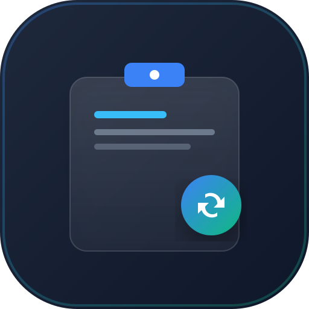

# 呆呆面板同步 (Daidai Sync)

  
  <h3>专为移动端打造的「呆呆面板」剪贴板环境变量极速同步工具</h3>
  
读取手机系统剪贴板 ➔ Open API 鉴权 ➔ 智能自动更新或新增环境变量，告别繁琐控制台操作

---

## 📖 项目简介

日常在使用 [呆呆面板 (daidai-panel)](https://github.com/linzixuanzz/daidai-panel) 定时任务管理系统时，移动端用户在各大 App 复制了最新的 Cookie 或 Token 后，通常需要繁琐地打开浏览器、输入密码登录面板后台、翻找环境变量、点击编辑、粘贴并保存。

**呆呆面板剪贴板同步助手** 专为打通这一“最后一公里”痛点而生：
只需在手机上复制内容，打开本应用即可自动或一键读取剪贴板，通过官方 Open API 密钥（`app_key` & `app_secret`）一键向指定的呆呆面板提交更新。

---

## ✨ 核心特性

- 📱 **双重运行形态**
  - **Android 原生 APK**：基于 Android 16 (SDK 36) 构建，集成原生系统级 `AndroidBridge` 剪贴板穿透与触觉震动，无缝适配沉浸式状态栏与打孔屏。
  - **渐进式 Web 应用 (PWA)**：支持在 Chrome / Edge / 三星浏览器中直接一键“安装到桌面”，秒开运行，无需反复打包。
- 📋 **极速剪贴板交互**
  - **启动自读**：支持开启“打开应用时自动读取剪贴板”，实现“复制 ➔ 打开 App ➔ 点同步”的 3 秒闭环。
  - **双轨输入**：同时提供“从剪贴板读取”与“手动粘贴”，并配有支持直接编辑的输入框，零阻断使用。
  - **隐私脱敏与格式清洗**：支持一键切换敏感信息掩码显示（`******`），内置“去除首尾空格”和“合并为单行”实用清洗工具。
- ⚡ **智能环境变量同步 (Upsert & 自动启用)**
  - 更新前先查询目标变量，**存在则调用更新覆盖，不存在则自动新增创建**，无需用户在面板后台预先手动占位。
  - **禁用自动启用**：若目标环境变量在面板中处于禁用状态，同步时将**自动将其恢复为启用状态**，确保定时任务脚本能立即正常加载该变量。
  - 支持在工作台中临时一键切换当前目标变量名，并在设置中可自由启闭自动启用开关。
- 🔍 **面板变量实时浏览器**
  - 可直接在 App 内在线检索并浏览当前呆呆面板中的所有环境变量及其启用/禁用状态。
  - 针对被禁用的环境变量，提供一键直接「启用」快捷操作，支持一键将任意变量“设为同步目标”。
- 🕒 **同步历史归档与快速回放**
  - 本地自动归档近期的每一次同步记录（时间、耗时、状态、内容摘要），支持一键复制或重新载入工作台重发。
- 🌐 **网络跨域与局域网兼容**
  - 支持智能网络回退机制：当直接连接遇到移动端 CORS 跨域或 HTTPS/HTTP 混合内容限制时，自动通过应用服务端中继代理，局域网与公网均可畅通访问。

---

## 🔑 呆呆面板后台凭据获取指引

在使用本应用前，请先前往您的呆呆面板后台生成 API 调用凭据：

1. 登录您的呆呆面板管理后台（默认地址一般为 `http://<服务器IP>:5700`）；
2. 点击左侧导航栏的 **【应用管理】**（或 **Open API**）；
3. 点击右上角 **【新建应用】**，填写自定义应用名称（例如：`剪贴板同步助手`）；
4. ⚠️ **关键权限配置**：在权限列表中务必勾选 **【环境变量】**（`envs`）读写权限；
5. 创建完成后，复制生成的 **`AppKey`** 与 **`AppSecret`**；
6. 打开本应用底部导航的 **【连接设置】**，填入：
   - **面板 API 地址**：如 `http://192.168.1.100:5700` 或已反代的公网域名
   - **应用 AppKey** 与 **应用 AppSecret**
7. 点击 **【测试连接】**，提示“连接成功”并显示延迟即可开始使用！

